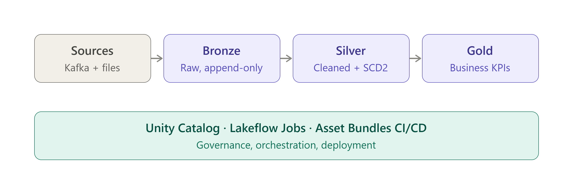

# E-commerce Streaming Pipeline on Databricks Lakehouse


An end-to-end, production-style data pipeline that ingests e-commerce orders,
customer change data (CDC), and product data incrementally, processes them
through a medallion architecture.
Everything is defined as code and deployed through CI/CD.



---

## Architecture

```
JSON files (Volume)
      │
      ▼
 Bronze  ── raw, append-only Delta tables (Auto Loader)
      │
      ▼
 Silver  ── typed, deduplicated, quality-checked data
      │      ├── silver_orders + quarantine table
      │      ├── silver_customers_scd2 (history)
      │      └── silver_products
      ▼
 Gold    ── business KPIs (materialized views)


Governance: Unity Catalog  |  Orchestration: Lakeflow Jobs  |  Deployment: Asset Bundles + GitHub Actions
```

---

## Tech stack

| Area | Tools |
|---|---|
| Platform | Databricks (Free Edition), Unity Catalog |
| Processing | PySpark, Lakeflow Declarative Pipelines, Auto Loader |
| Storage | Delta Lake, liquid clustering |
| Orchestration | Lakeflow Jobs (retries, timeouts, alerts) |
| Deployment | Databricks Asset Bundles, GitHub Actions |
| Testing | pytest, post-load data quality checks |

---

## Data model

| Layer | Table | Description |
|---|---|---|
| Bronze | `bronze_orders` | Raw orders with source file and ingestion time |
| Bronze | `bronze_customers` | Raw customer CDC events (INSERT / UPDATE) |
| Bronze | `bronze_products` | Raw product reference data |
| Silver | `silver_orders` | Clean, typed, deduplicated orders |
| Silver | `silver_orders_quarantine` | Records that failed quality rules |
| Silver | `silver_customers_scd2` | Full customer history (SCD Type 2) |
| Silver | `silver_customers_current` | Latest version of each customer |
| Silver | `silver_products` | Clean product data |
| Gold | `gold_daily_sales` | Daily revenue, orders, and AOV by category |
| Gold | `gold_customer_metrics` | Customer lifetime value and order history |
| Gold | `gold_revenue_by_city` | Revenue by customer city at time of order |

---

## Key engineering decisions

**Incremental ingestion.** Auto Loader processes only new files, with schema
evolution and a rescued-data column so unexpected fields are never lost.
Audit columns (`_source_file`, `_ingested_at`) trace every row to its origin.

**Data quality without data loss.** Declarative expectations drop invalid rows
from Silver, but those rows are routed to a quarantine table instead of being
silently deleted. Rules are defined once and shared by both tables.

**Bounded streaming deduplication.** Duplicates are removed using a watermark,
so streaming state doesn't grow forever.

**SCD Type 2 with late-data handling.** Customer changes are tracked with full
history using declarative CDC, sequenced by event time so out-of-order updates
never overwrite newer data.

**Point-in-time joins.** Revenue is attributed to the city a customer lived in
*when the order was placed*, not where they live today.

**Validation that fails loudly.** A post-load task checks cross-table rules
(revenue reconciliation, one current row per customer, quarantine rate, data
freshness) and fails the job, triggering an email alert.

**Environment isolation.** Dev and prod targets deploy to separate schemas.
Paths and schemas are injected as configuration, never hardcoded.

---

## Data quality rules

| Rule | Condition | Action |
|---|---|---|
| Valid order ID | `order_id IS NOT NULL` | Drop and quarantine |
| Valid customer | `customer_id IS NOT NULL` | Drop and quarantine |
| Positive amount | `amount > 0` | Drop and quarantine |
| Valid quantity | `quantity > 0` | Drop and quarantine |
| Valid price | `price > 0` | Drop |

---

## SCD Type 2 example

| customer_id | city | __START_AT | __END_AT |
|---|---|---|---|
| C0066 | North Stacytown | 2026-10-26 06:22 | 2026-10-26 07:12 |
| C0066 | Port Peggy | 2026-10-26 07:12 | NULL (current) |

---

## Orchestration

```
generate_data  →  run_pipeline  →  quality_checks
```

The job includes task retries, a 30-minute timeout, and email alerts on failure.

## CI/CD

| Event | What happens |
|---|---|
| Pull request to `main` | Unit tests run and the bundle is validated |
| Merge to `main` | Tests run, then the project deploys to prod |

---

## Results

- Revenue reconciles exactly between the Silver and Gold layers
- Every injected bad record is captured in the quarantine table
- Bronze-to-Silver row counts fully reconcile (quarantined rows + duplicates)
- The full project deploys from a single `git push`


---

## Repository structure

```
ecom-lakehouse/
├── .github/
│   └── workflows/
│       └── ci-cd.yml              # Tests on PR, deploys to prod on merge
├── docs/
│   ├── pipeline_graph.png         # Pipeline lineage screenshot
│  
├── src/
│   ├── notebooks/
│   │   ├── 00_setup.py            # Creates schema and volume
│   │   ├── 01_data_generator.py   # Synthetic orders, customer CDC, products
│   │   └── 02_quality_checks.py   # Post-load validation (fails job on error)
│   ├── pipelines/
│   │   ├── bronze.py              # Auto Loader ingestion
│   │   ├── silver.py              # Cleaning, expectations, quarantine, dedup
│   │   ├── silver_customers.py    # SCD Type 2 customer dimension
│   │   └── gold.py                # Business KPIs and point-in-time joins
│   └── utils/
│       ├── __init__.py
│       └── transforms.py          # Reusable, unit-tested transformation logic
├── tests/
│   └── test_transforms.py         # pytest unit tests
├── .gitignore
├── databricks.yml                 # Asset Bundle: pipeline, job, dev/prod targets
├── pytest.ini
├── requirements-dev.txt
└── README.md
```

---

## Getting started

**Prerequisites:** a Databricks workspace (Free Edition works), the Databricks
CLI, and Python 3.10+.

```bash
# 1. Clone
git clone https://github.com/<thehaseebi>/ecom-lakehouse.git
cd ecom-lakehouse

# 2. Authenticate
databricks configure --host https://<your-workspace-url>

# 3. Run unit tests
pip install -r requirements-dev.txt
pytest -v

# 4. Deploy and run in dev
databricks bundle validate
databricks bundle deploy -t dev
databricks bundle run ecom_daily_job -t dev
```

---

## Future improvements

- Replace file-based ingestion with a real Kafka stream
- Use a service principal instead of a personal token for CI/CD
- Add pipeline monitoring dashboards built on the event log
- Add customer delete handling (`apply_as_deletes`) for GDPR-style requests

---

## Author

**Haseeb** | [LinkedIn](https://www.linkedin.com/in/haseebahmad76/)
